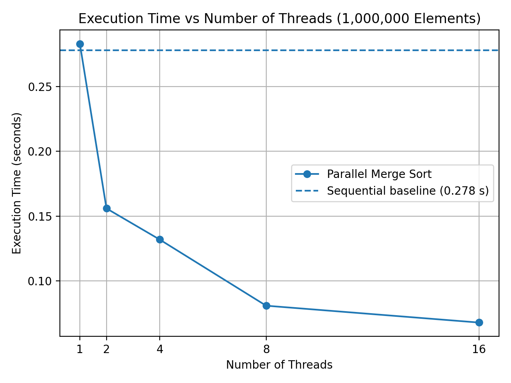
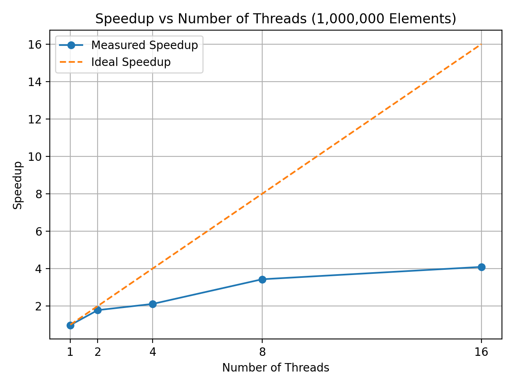
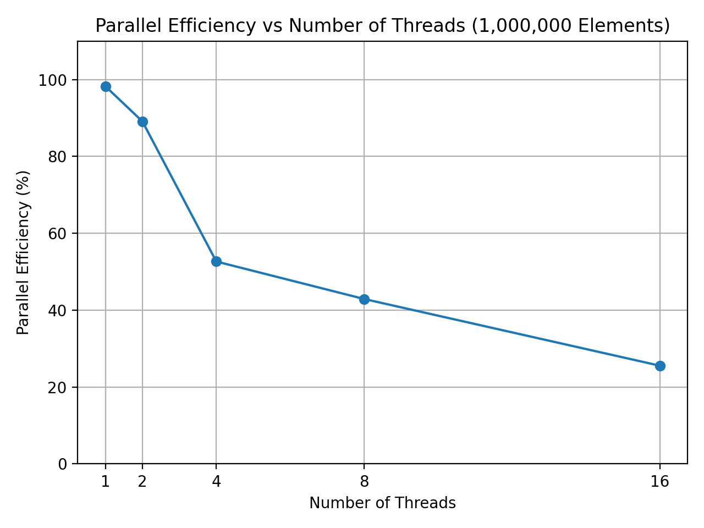
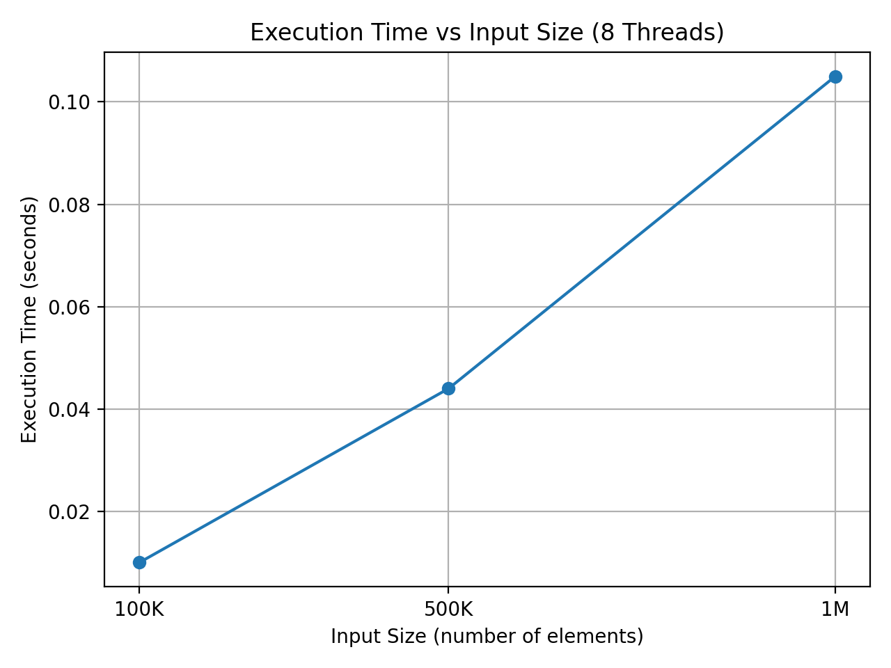

# DAA_Parallel_Merge_Sort

## Sequential and Parallel Merge Sort Performance Comparison Using OpenMP

## 1. Problem Statement

Develop sequential and parallel implementations of Merge Sort and compare their performance for increasingly large datasets.

## 2. Objectives

- Implement sequential Merge Sort in C.
- Implement parallel Merge Sort using OpenMP tasks.
- Compare execution time for different input sizes.
- Evaluate performance using different thread counts.
- Calculate speedup and parallel efficiency.
- Verify the correctness of both implementations.

## 3. Technologies Used

- C Programming
- OpenMP
- GCC Compiler
- MSYS2 UCRT64
- Visual Studio Code
- Windows 11

## 4. Project Files

| File | Description |
|---|---|
| `sequential_merge_sort.c` | Sequential Merge Sort implementation |
| `parallel_merge_sort.c` | Parallel Merge Sort using OpenMP tasks |
| `openmp_test.c` | Tests the OpenMP environment |
| `input_size_scaling.csv` | Execution-time data for different input sizes |
| `thread_scaling.csv` | Execution time, speedup, and efficiency for different thread counts |
| `execution_time_vs_threads.png` | Execution time comparison for different thread counts |
| `speedup_vs_threads.png` | Measured and ideal speedup comparison |
| `parallel_efficiency_vs_threads.png` | Parallel efficiency for different thread counts |
| `execution_time_vs_input_size.png` | Execution time for different input sizes |

## 5. Algorithm

Merge Sort follows the Divide and Conquer approach:

1. Divide the array into two halves.
2. Recursively sort the left half.
3. Recursively sort the right half.
4. Merge the sorted halves.
5. Repeat until the complete array is sorted.

The parallel implementation uses OpenMP tasks to process the two halves concurrently. For subarrays of size 10,000 or smaller, the program uses sequential Merge Sort to reduce task-creation overhead.

## 6. Compilation

Compile the sequential implementation:

```bash
gcc -fopenmp sequential_merge_sort.c -o sequential_merge_sort.exe
```

Compile the parallel implementation:

```bash
gcc -fopenmp parallel_merge_sort.c -o parallel_merge_sort.exe
```

Compile the OpenMP test:

```bash
gcc -fopenmp openmp_test.c -o openmp_test.exe
```

## 7. Execution

Run sequential Merge Sort with the default input size of 1,000,000:

```bash
sequential_merge_sort.exe
```

Run parallel Merge Sort with the default input size:

```bash
parallel_merge_sort.exe
```

Run with a custom input size:

```bash
sequential_merge_sort.exe 100000
parallel_merge_sort.exe 100000
```

Set the thread count in Windows Command Prompt:

```cmd
set OMP_NUM_THREADS=8
parallel_merge_sort.exe
```

Run the OpenMP test:

```bash
openmp_test.exe
```

## 8. Experimental Setup

- Operating System: Windows 11
- Compiler: GCC 16.2.0 (MSYS2 UCRT64)
- Parallel programming model: OpenMP
- Random seed: 42
- Random values: `rand() % 100000`
- Task threshold: 10,000 elements
- Timing function: `omp_get_wtime()`
- Correctness verification: `isSorted()`
- Thread counts tested: 1, 2, 4, 8, and 16
- Input sizes tested: 100,000, 500,000, and 1,000,000 elements

## 9. Performance Metrics

### Speedup

Speedup measures the performance improvement achieved by the parallel implementation compared with the sequential baseline.

**Formula:**

Speedup = Sequential Execution Time / Parallel Execution Time

### Parallel Efficiency

Parallel efficiency measures how effectively the available threads are utilized.

**Formula:**

Parallel Efficiency = (Speedup / Number of Threads) × 100

The sequential baseline used for the thread-scaling experiment was 0.278 seconds.

## 10. Thread-Scaling Results

The following results were recorded for 1,000,000 elements.

| Threads | Parallel Time (s) | Speedup | Efficiency (%) |
|---:|---:|---:|---:|
| 1 | 0.283 | 0.98× | 98.23 |
| 2 | 0.156 | 1.78× | 89.10 |
| 4 | 0.132 | 2.11× | 52.65 |
| 8 | 0.081 | 3.43× | 42.90 |
| 16 | 0.068 | 4.09× | 25.55 |

The best recorded execution time in this experiment was 0.068 seconds using 16 threads, corresponding to a speedup of approximately 4.09×.

Execution time decreased as the thread count increased in the recorded experiment. However, parallel efficiency decreased at higher thread counts because of task-management overhead, synchronization, memory bandwidth limitations, and the sequential portions of the algorithm.

## 11. Input-Size Scaling Results

The following results were recorded while using 8 threads.

| Input Size | Execution Time (s) |
|---:|---:|
| 100,000 | 0.010 |
| 500,000 | 0.044 |
| 1,000,000 | 0.105 |

Execution time increased as the input size increased because more elements had to be divided, sorted, and merged.

The 1,000,000-element timing in this experiment differs from the 8-thread result in the thread-scaling experiment because the measurements came from separate experimental runs.

## 12. Task Threshold Experiment

Creating too many OpenMP tasks can increase scheduling and synchronization overhead.

In the reported experiment, unrestricted task creation took approximately 2.843 seconds for 1,000,000 elements with 16 threads, compared with the sequential baseline of 0.278 seconds.

Using `TASK_THRESHOLD 10000` reduced the measured time to approximately 0.102 seconds in the corresponding test. The best final recorded thread-scaling result was 0.068 seconds.

Only one threshold value was tested. Evaluating additional threshold values is a possible future improvement.

## 13. Correctness Verification

Both implementations use the `isSorted()` function to verify that each element is no greater than the next element.

The recorded runs confirmed that the arrays were sorted correctly.

## 14. Complexity Analysis

For Merge Sort:

- **Time complexity:** O(n log n)
- **Auxiliary space complexity:** O(n)

The parallel implementation can reduce execution time by distributing recursive sorting tasks across multiple threads. The actual performance improvement depends on task overhead, synchronization, memory access, and available hardware resources.

## 15. Performance Graphs

### 15.1 Execution Time vs Number of Threads

This graph compares parallel execution time across different thread counts for an input of 1,000,000 elements.



### 15.2 Speedup vs Number of Threads

This graph compares measured speedup with ideal linear speedup.



### 15.3 Parallel Efficiency vs Number of Threads

This graph shows how parallel efficiency changes as the number of threads increases.



### 15.4 Execution Time vs Input Size

This graph compares execution time for input sizes of 100,000, 500,000, and 1,000,000 elements using 8 threads.



## 16. Limitations

- Performance depends on hardware and system load.
- OpenMP task creation and synchronization introduce overhead.
- Memory bandwidth and cache behavior can limit scalability.
- Sequential portions of the algorithm limit the maximum achievable speedup.
- Only one task-threshold value was evaluated.

## 17. Future Scope

- Evaluate additional task-threshold values.
- Repeat experiments to study timing variation.
- Compare performance across different hardware configurations.
- Explore additional parallelization strategies.

## 18. Team Members

- Nandini Waghmare
- Ruchita Telang
- Anchal Parteki

## 19. Project Type

DAA Mini Project
